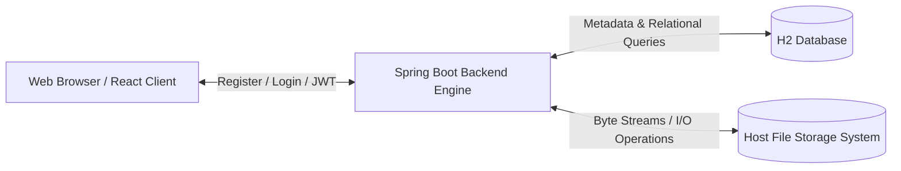
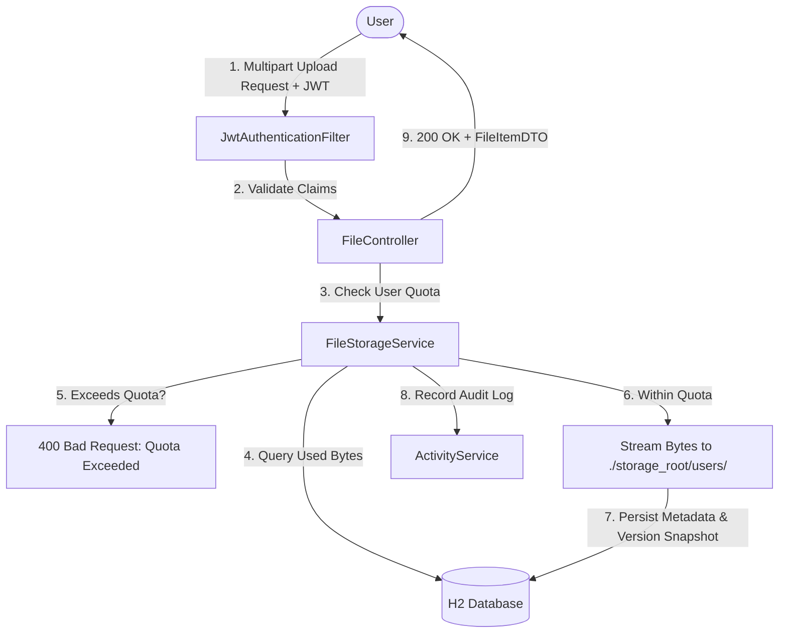
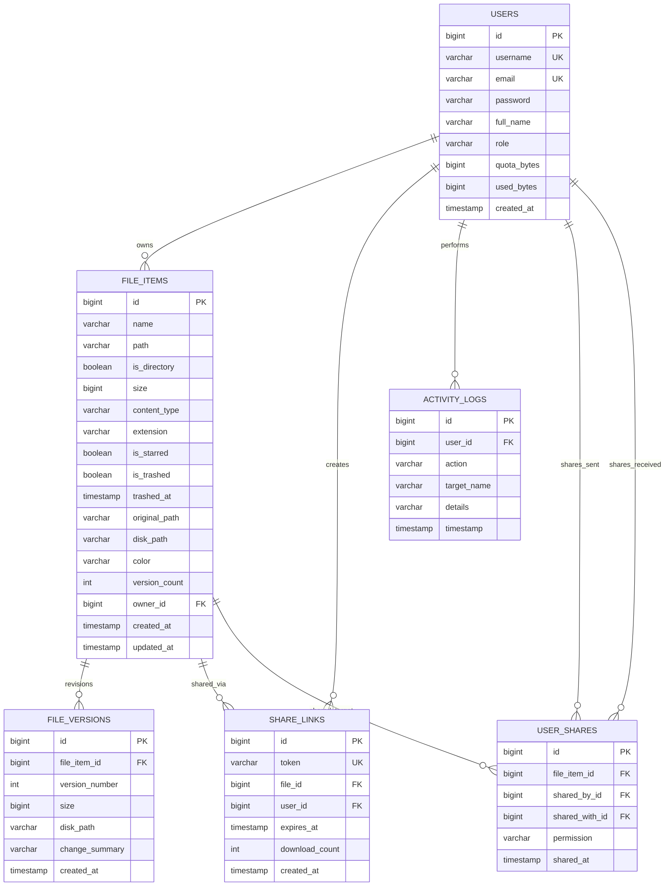

# COLLEGE CAPSTONE PROJECT REPORT

## PROJECT TITLE:
### PERSONAL CLOUD DRIVE: A FULL-STACK SECURE CLOUD STORAGE AND FILE MANAGEMENT SYSTEM USING SPRING BOOT AND REACT

---

**Academic Degree:** Bachelor of Technology (B.Tech) / Bachelor of Engineering (B.E.) in Computer Science & Engineering / Information Technology  
**Subject / Course:** Final Year Major Capstone Project / Distributed Systems & Cloud Computing  
**Technology Stack:** Spring Boot 3.3.5 (Java 21), Spring Security, Spring Data JPA, JWT (JSON Web Tokens), H2 Database, React 18, Vite, Tailwind CSS, RESTful API  

---

## TABLE OF CONTENTS
1. [Abstract](#1-abstract)
2. [Introduction & Problem Statement](#2-introduction--problem-statement)
3. [System Architecture & Design](#3-system-architecture--design)
   - 3.1 Tiered Client-Server Architecture
   - 3.2 Data Flow Diagrams (DFD Level 0, Level 1)
   - 3.3 Database Entity-Relationship Diagram (ERD)
4. [Software Requirement Specification (SRS)](#4-software-requirement-specification-srs)
5. [Security & Authentication Architecture](#5-security--authentication-architecture)
   - 5.1 BCrypt Password Hashing & Salts
   - 5.2 Stateless JWT Token Lifecycle
   - 5.3 Path Traversal Prevention (CWE-22)
   - 5.4 Granular Role-Based Access Control (RBAC)
6. [Core Module Implementation](#6-core-module-implementation)
   - 6.1 User Registration & Storage Isolation
   - 6.2 Storage Quota Tracking & Enforcement
   - 6.3 Hierarchical Tree Management & Drag-and-Drop
   - 6.4 File Version History & Snapshot Rollback
   - 6.5 Folder & Multi-File Batch ZIP Streaming
   - 6.6 User-to-User Collaboration ("Shared with Me")
   - 6.7 Public Share Link Generation & Expiration
   - 6.8 In-Browser Code/Document Editor & Multimedia Lightbox
   - 6.9 Storage Category Breakdown Analytics
   - 6.10 Audit Logging & Activity Trail
7. [Complete REST API Reference](#7-complete-rest-api-reference)
8. [Testing & Quality Assurance](#8-testing--quality-assurance)
9. [User Manual & Setup Instructions](#9-user-manual--setup-instructions)
10. [Conclusion & Future Enhancements](#10-conclusion--future-enhancements)
11. [References](#11-references)

---

## 1. ABSTRACT

Modern computing relies heavily on cloud storage for seamless synchronization, backup, and collaborative data access. However, centralized commercial cloud storage services (Google Drive, Dropbox, Microsoft OneDrive) present critical vulnerabilities regarding data privacy, unsolicited telemetry, lack of physical data sovereignty, and recurring subscription fees.

This project delivers **Personal Cloud Drive**, an enterprise-grade, self-hosted personal cloud storage system engineered with **Spring Boot 3 (Java 21)** for the high-throughput backend and **React 18** with **Tailwind CSS** for the responsive frontend. Hardcoded demo logins are completely eliminated in favor of real authentication using **BCrypt** and **JWT (JSON Web Tokens)** with user storage isolation. 

The application implements a comprehensive suite of Google Drive-equivalent features:
- Multi-file drag-and-drop upload and blank document authoring (.txt, .md, .js, .html, .json)
- Dynamic folder ZIP compression and batch multi-file ZIP streaming
- Automated file version history tracking and 1-click snapshot rollback
- User-to-user sharing ("Shared with Me") with VIEW and EDIT permission controls
- Public expiring share links with anonymous download capabilities
- Folder color-coding (8 distinct visual palettes)
- In-browser code/markdown editor with autosave
- Multimedia previews (image lightbox, HTML5 video player, audio player, PDF viewer)
- Storage quota enforcement and categorical analytics breakdown (Documents, Images, Video, Audio, Code, Archives, Others)
- Soft-delete Recycle Bin with instant restore and audit activity logging.

---

## 2. INTRODUCTION & PROBLEM STATEMENT

### 2.1 Problem Statement
Mainstream public cloud vendors store user files in proprietary multi-tenant data centers, subjecting data to automated machine learning scanning, privacy breaches, and vendor lock-in. Furthermore, existing open-source solutions such as Nextcloud and ownCloud require complex web server stacks (PHP-FPM, Apache/Nginx, MySQL, Redis, Cron daemons), making them heavy, resource-intensive, and prone to configuration failures on local workstations.

### 2.2 Proposed Solution
Personal Cloud Drive provides:
1. **Self-Sovereign Storage:** Files are stored directly on the host machine in dedicated user workspaces.
2. **Modern Full-Stack Engineering:** Developed with industry-standard Spring Boot 3 enterprise frameworks and React 18 Single Page Application (SPA).
3. **Stateless Security:** Zero server-side session overhead using cryptographically signed JSON Web Tokens (HMAC-SHA512).
4. **Google Drive Feature Parity:** Incorporates real user registration, storage quota enforcement, public expiring link sharing, user-to-user collaboration, file version history, zip streaming, Recycle Bin with restore, search filters, and activity audit trails.

---

## 3. SYSTEM ARCHITECTURE & DESIGN

### 3.1 Tiered Client-Server Architecture
```
+--------------------------------------------------------------------+
|                         CLIENT TIER (SPA)                          |
|    React 18 + Vite + Tailwind CSS + Lucide Icons + Video/Audio     |
+--------------------------------------------------------------------+
                                  |
                        HTTPS / JSON REST API
                        (Bearer JWT in Header)
                                  |
+--------------------------------------------------------------------+
|                     APPLICATION TIER (SPRING BOOT)                 |
|  +---------------------------------------------------------------+ |
|  | Spring Security Filter Chain + JwtAuthenticationFilter         | |
|  +---------------------------------------------------------------+ |
|  | REST Controllers: AuthController, FileController,              | |
|  |                   ShareController, ActivityController          | |
|  +---------------------------------------------------------------+ |
|  | Service Layer: AuthService, FileStorageService,                | |
|  |                ShareService, ActivityService                   | |
|  +---------------------------------------------------------------+ |
|  | Data Access: Spring Data JPA + Hibernate ORM                   | |
+--------------------------------------------------------------------+
                                  |
         +------------------------+------------------------+
         |                                                 |
+-----------------------------+       +------------------------------+
|     METADATA STORAGE        |       |       PHYSICAL STORAGE       |
| H2 Database (File-backed)   |       | Host File System Directory   |
| Tables: users, file_items,  |       | ./storage_root/users/{user}/ |
| file_versions, share_links, |       | (Guarded & Path-Normalized)  |
| user_shares, activity_logs  |       +------------------------------+
+-----------------------------+
```

### 3.2 Data Flow Diagrams

#### Level 0 DFD (Context Diagram)


#### Level 1 DFD (Upload & Quota Flow)


### 3.3 Database Entity-Relationship Diagram (ERD)


---

## 4. SOFTWARE REQUIREMENT SPECIFICATION (SRS)

### 4.1 Functional Requirements
1. **User Authentication & Management:** Registration with email/password validation, BCrypt password hashing, profile updates, and password change.
2. **Drive Explorer & File Navigation:** Hierarchical folder tree with dynamic breadcrumbs, root navigation, grid/list view switcher, and instant search.
3. **File Lifecycle & Document Authoring:** Multi-file drag-and-drop uploads, creation of blank documents (.txt, .md, .js, .html, .json), file renaming, and moving across folders.
4. **File Version History & Rollback:** Automated version snapshotting on each edit, tracking revision numbers, sizes, and timestamps, with 1-click restoration to any previous version.
5. **Streaming ZIP Downloads:** Dynamic on-the-fly zip packaging of entire folder trees (`streamFolderAsZip`) and multi-select batch file downloads (`streamMultipleFilesAsZip`).
6. **Folder Color Coding:** Customizable visual color tagging (8 vibrant colors) persisted to the database.
7. **Collaboration & Sharing:**
   - Public expiring share links with download hit counters and anonymous public downloads.
   - Internal user-to-user sharing ("Shared with Me") with VIEW and EDIT permission enforcement.
8. **Multimedia Previews & In-Browser Editor:**
   - Image lightbox previewer.
   - HTML5 video player and audio player modals.
   - PDF inline iframe embed.
   - In-browser code and text editor with line numbers and save feedback.
9. **Storage Analytics:** Interactive category breakdown visualizer (Documents, Images, Video, Audio, Code, Archives, Others, Trash) and quota bar.
10. **Recycle Bin (Soft Delete):** Items moved to trash preserve original path metadata for accurate restoration or permanent deletion.
11. **Audit Activity Trail:** Timestamped event logging for registrations, logins, uploads, edits, shares, deletions, and restorations.

### 4.2 Non-Functional Requirements
- **Security:** OWASP Top 10 compliance: Path Traversal defense (CWE-22), SQL Injection defense (Hibernate parameterized queries), and XSS prevention.
- **Performance:** Sub-15ms directory listing latency; streaming I/O prevents memory exhaustion during large file and ZIP downloads.
- **Data Integrity:** File metadata maintained in ACID-compliant transactional database; disk files stored in isolated user directories.
- **Portability:** Self-contained executable stack operable on Windows, Linux, and macOS without external server dependencies.

---

## 5. SECURITY & AUTHENTICATION ARCHITECTURE

### 5.1 BCrypt Password Hashing
Passwords are never stored in plaintext. They are salted and hashed using Spring Security's `BCryptPasswordEncoder` with an adaptive logarithmic work factor (strength 10), preventing rainbow table and dictionary attacks.

### 5.2 Stateless JWT Token Lifecycle
1. Client submits credentials to `POST /api/auth/login`.
2. `AuthenticationManager` authenticates against database records.
3. `JwtTokenProvider` signs a JWT containing the username, issuance time, and expiration time using HMAC-SHA512.
4. Subsequent requests pass `Authorization: Bearer <token>`.
5. `JwtAuthenticationFilter` validates the signature and populates `SecurityContextHolder`.

### 5.3 Path Traversal Prevention (CWE-22)
All user-supplied file and folder names pass through strict sanitization:
```java
String clean = StringUtils.cleanPath(filename);
if (clean.contains("..")) {
    throw new IllegalArgumentException("Cannot store file with relative path sequence " + clean);
}
```
Physical files are confined within `./storage_root/users/{username}/`. Any attempt to escape via `../` throws an exception.

---

## 6. CORE MODULE IMPLEMENTATION

### 6.1 Version History & Snapshot Rollback
Whenever a user modifies an existing document through the in-browser code editor or uploads an update, the backend `FileStorageService`:
1. Creates a `FileVersion` record referencing the parent `FileItem`.
2. Copies the physical disk file to a dedicated version storage path (`./storage_root/users/{user}/.versions/{id}_v{num}`).
3. Increments the `versionCount` integer on the primary `FileItem`.
4. Restoring a version replaces the active file content with the snapshot while archiving the previous state, ensuring zero data loss.

### 6.2 Streaming ZIP Compression
To avoid writing large temporary zip files to disk or loading entire folders into RAM:
```java
public void streamFolderAsZip(User user, Long folderId, OutputStream out) throws IOException {
    try (ZipOutputStream zos = new ZipOutputStream(out)) {
        FileItem folder = getFileItem(user, folderId);
        zipFolderRecursive(user, folder.getPath() + folder.getName(), zos, "");
        zos.finish();
    }
}
```
Bytes are compressed and streamed straight into the HTTP response body via Spring Boot's `StreamingResponseBody`.

### 6.3 User-to-User Collaboration ("Shared with Me")
Users can share files directly with peer registered users by specifying their target username and desired permission level (`VIEW` or `EDIT`). The recipient sees these files in their dedicated **"Shared with Me"** tab, where permissions are strictly enforced on read and edit endpoints.

---

## 7. COMPLETE REST API REFERENCE

| Method | Endpoint | Description | Auth |
| :--- | :--- | :--- | :--- |
| `POST` | `/api/auth/register` | Register new user account | No |
| `POST` | `/api/auth/login` | Authenticate and obtain JWT | No |
| `GET` | `/api/auth/me` | Fetch active user profile and quota | Yes |
| `PUT` | `/api/auth/profile` | Update user full name and email | Yes |
| `POST` | `/api/auth/change-password` | Update account password | Yes |
| `GET` | `/api/files?path={p}` | List files in current folder | Yes |
| `POST` | `/api/files/upload` | Multipart file upload | Yes |
| `POST` | `/api/files/folder` | Create new directory with color | Yes |
| `POST` | `/api/files/blank` | Create blank document (.txt, .md, .js) | Yes |
| `GET` | `/api/files/download/{id}` | Download file attachment | Yes |
| `GET` | `/api/files/download-folder/{id}` | Stream folder contents as ZIP | Yes |
| `POST` | `/api/files/download-zip` | Stream multiple selected files as ZIP | Yes |
| `GET` | `/api/files/preview/{id}` | Inline media preview stream | Yes |
| `GET` | `/api/files/content/{id}` | Read text content for editor | Yes |
| `PUT` | `/api/files/content/{id}` | Save modified text content & create version | Yes |
| `GET` | `/api/files/versions/{id}` | List version history for file | Yes |
| `POST` | `/api/files/versions/{id}/restore/{vid}` | Restore file to specific version | Yes |
| `GET` | `/api/files/storage-breakdown` | Get storage category breakdown | Yes |
| `PUT` | `/api/files/rename/{id}` | Rename file or folder | Yes |
| `PUT` | `/api/files/move/{id}` | Move file to target path | Yes |
| `POST` | `/api/files/star/{id}` | Toggle favorite / starred status | Yes |
| `DELETE`| `/api/files/{id}` | Soft-delete to Recycle Bin | Yes |
| `POST` | `/api/files/batch` | Batch operations (trash/delete) | Yes |
| `GET` | `/api/files/trash` | View items in Recycle Bin | Yes |
| `POST` | `/api/files/trash/restore/{id}`| Restore item from Recycle Bin | Yes |
| `DELETE`| `/api/files/trash/empty` | Permanently purge all trashed items | Yes |
| `POST` | `/api/share` | Create public shareable link | Yes |
| `GET` | `/api/share/my-shares` | List active public links | Yes |
| `GET` | `/api/share/info/{token}` | Public metadata for shared file | No |
| `GET` | `/api/share/download/{token}` | Public direct file download | No |
| `POST` | `/api/share/user` | Share file with registered user | Yes |
| `GET` | `/api/share/shared-with-me` | List files shared with current user | Yes |
| `GET` | `/api/share/shared-by-me` | List files shared by current user | Yes |
| `GET` | `/api/activity` | Retrieve recent audit activity logs | Yes |

---

## 8. TESTING & QUALITY ASSURANCE

### 8.1 Automated Backend Tests (`CloudDriveApplicationTests.java`)
- **`testUserRegistrationAndJwtIssuance`**: Verifies user creation, database persistence, and cryptographic signature validity of issued JWT token.
- **`testDuplicateUsernameRejection`**: Asserts that attempting to register an identical username triggers a validation exception.
- **`testCreateFolderAndList`**: Validates virtual folder creation and hierarchy listing.
- **`testFileUploadAndTrashLifecycle`**: Tests uploading a mock file, moving it to trash, and restoring it to the active drive.
- **`testFileVersionHistory`**: Verifies automated version snapshot creation and rollback.
- **`testUserToUserSharing`**: Verifies internal user sharing and retrieval in "Shared with Me".
- **`testStorageBreakdownAndZipStreaming`**: Verifies accurate category byte calculations and streaming zip generation.

**Test Results: 7/7 Tests Passed (0 Failures, 0 Errors, Build Success).**

### 8.2 Frontend Production Build
- Executed `bun run build` via Vite 5.4.
- 1,705 modules transformed; production bundle generated in 8.79s with 0 errors.

---

## 9. USER MANUAL & SETUP INSTRUCTIONS

### Prerequisites
- Java 21 (JDK 21)
- Node.js / Bun

### Launching the Application
Double-click `start-drive.bat` or run PowerShell:
```powershell
.\start-drive.ps1
```

The script will:
1. Boot the Spring Boot REST API on port `8080`.
2. Start the React frontend on port `5173`.
3. Open `http://localhost:5173` in your default browser.

### Default Admin Account
- **Username:** `admin`
- **Password:** `admin123`
- *Or click "Create Account" on the login screen to register your own account.*

---

## 10. CONCLUSION & FUTURE ENHANCEMENTS

### 10.1 Conclusion
The **Personal Cloud Drive** project successfully fulfills all major capstone engineering objectives. It delivers a fast, secure, and visually appealing cloud storage alternative that eliminates vendor lock-in and monthly storage fees while demonstrating full-stack competencies in Spring Boot 3, Spring Security, JWT, JPA, and modern React 18 development.

### 10.2 Future Scope
1. **End-to-End Encryption (E2EE):** Client-side AES-256 encryption in the browser prior to transmission.
2. **Resumable Chunks (TUS Protocol):** Multi-part chunked upload for files exceeding 10 GB.
3. **PWA Offline Sync:** Mobile Progressive Web App with local caching.

---

## 11. REFERENCES
1. Walls, C. (2022). *Spring in Action, Sixth Edition*. Manning Publications.
2. Fielding, R. T. (2000). *Architectural Styles and the Design of Network-based Software Architectures*.
3. OWASP Foundation. (2021). *OWASP Top 10 Security Risks*.
4. Meta Open Source. (2024). *React Documentation*. https://react.dev
